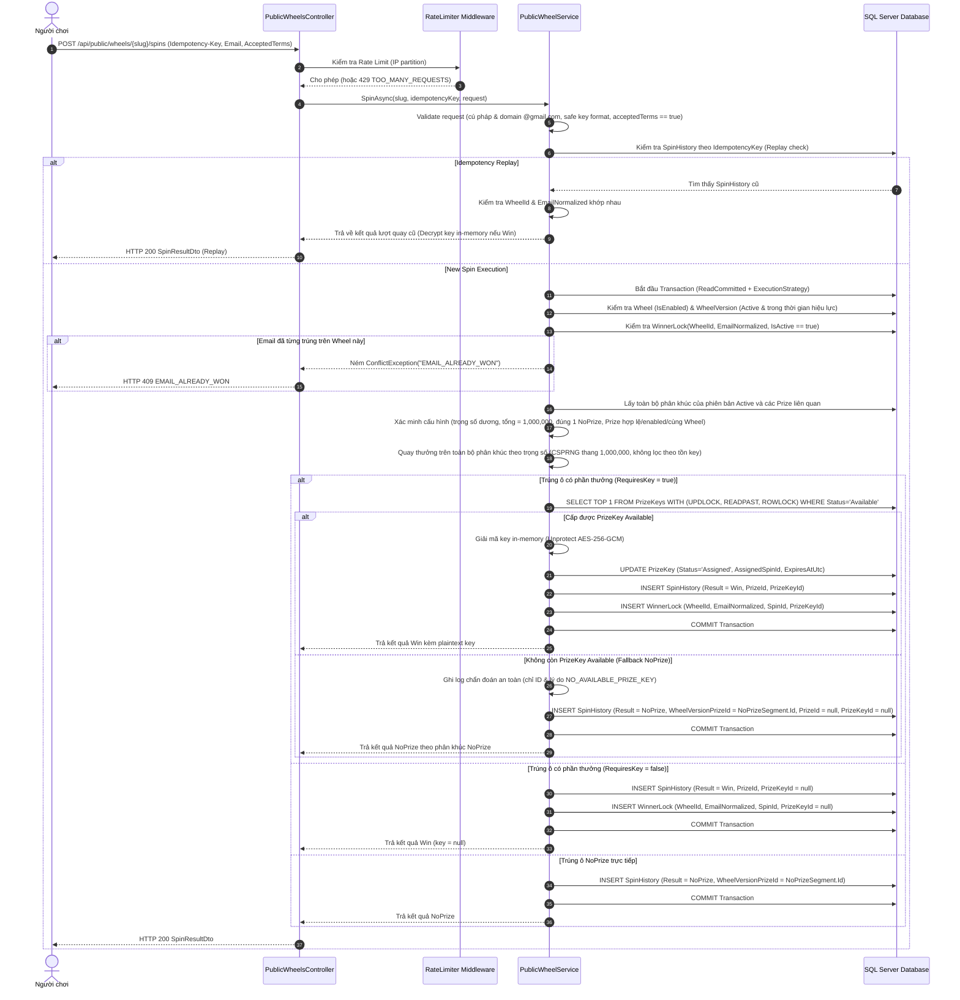

# Giai đoạn 8: Public Wheel & Spin Engine

## 1. Mục tiêu và phạm vi

- **Mục tiêu:** Triển khai luồng quay thưởng công khai (`Public Wheel & Spin Engine`) cho người dùng tham gia quay may mắn với Gmail, đảm bảo tính đúng đắn nghiệp vụ, giao dịch nguyên tử (atomic transaction), chống race condition / tranh chấp khóa thưởng, xử lý idempotent chặt chẽ và bảo vệ tuyệt đối thông tin nhạy cảm (`PrizeKey`).
- **Phạm vi đã thực hiện:**
    - `GET /api/public/wheels/{slug}`: Lấy thông tin vòng quay active theo slug (chỉ trả label, color, imageUrl, displayOrder, isNoPrize; tuyệt đối không để lộ weight, tổng số key còn lại, hoặc dữ liệu nhạy cảm).
    - `POST /api/public/wheels/{slug}/spins`: API quay thưởng công khai với header `Idempotency-Key` và payload `{ email, acceptedTerms }`.
    - Quy tắc xác thực và chuẩn hóa Gmail theo `LUCKY_WHEEL_BUSINESS_RULES.md` (§8): kiểm tra Gmail hợp lệ trước khi chuẩn hóa, trim whitespace, lowercase, chỉ chấp nhận domain `@gmail.com`, loại bỏ phần `+tag` và dấu chấm (`.`) trong local part; lưu `EmailOriginal` cho lịch sử và dùng `EmailNormalized` cho eligibility, `WinnerLock` và so sánh idempotency.
    - Khóa trúng thưởng `WinnerLock` theo cặp `(WheelId, EmailNormalized)`: người đã trúng giải (dù ở phiên bản nào) sẽ không được quay trúng thêm giải trên cùng một Wheel.
    - Thuật toán quay thưởng theo trọng số `WeightedPrizeSelector` sử dụng CSPRNG (`CryptoRandomNumberProvider` dựa trên `RandomNumberGenerator`), luôn bốc thăm trên toàn bộ phân khúc hợp lệ của phiên bản Active theo thang cố định `1,000,000` (không loại giải hết mã trước khi quay và không phân phối lại xác suất).
    - Phân bổ `PrizeKey` có điều kiện đồng thời cao: sử dụng SQL Server hint `UPDLOCK, READPAST, ROWLOCK` để chọn đúng 1 key `Available`, chuyển trạng thái sang `Assigned` và mã hóa/giải mã an toàn trong bộ nhớ; nếu giải được chọn không cấp được key `Available`, kết quả chuyển về luồng lưu/trả `NoPrize` dùng đúng phân khúc `NoPrize` của phiên bản đó (không tạo `WinnerLock`, không sửa key, trả HTTP 200).
    - Idempotency & Replay: Lưu trữ `IdempotencyKey` trong bảng `SpinHistories`. Nếu người chơi gửi lại cùng `Idempotency-Key`, cùng `WheelId` và cùng `EmailNormalized` (bao gồm các biến thể cùng Gmail hợp lệ), hệ thống sẽ trả lại kết quả đã lưu (giải mã in-memory key nếu trúng) mà không tiêu tốn thêm key hay tạo lượt quay mới. Nếu tái sử dụng `Idempotency-Key` với tham số khác, trả về HTTP 409 `IDEMPOTENCY_KEY_REUSED`.
    - Rate Limiting tích hợp của ASP.NET Core (.NET 8 built-in `FixedWindowRateLimiter`) chống spam và bruteforce trên endpoint spin.
    - Trạng thái Giai đoạn 8: Đang hoàn thiện theo từng bước (chưa đánh dấu `COMPLETED`; hành vi transaction/locking/race thực tế trên SQL Server cần được kiểm chứng riêng trên SQL Server).

---

## 2. Luồng xử lý giao dịch nguyên tử (Atomic Spin Transaction)



---

## 3. Các quy tắc nghiệp vụ cốt lõi

### 3.1 Quy tắc Gmail

- Email người chơi phải là địa chỉ Gmail hợp lệ trước khi chuẩn hóa và chỉ chấp nhận domain `@gmail.com` (không chấp nhận domain khác như `yahoo.com`, `gmail.com.vn`, `googlemail.com`, hay local part sai cú pháp như dấu chấm ở đầu/cuối, `..`, thiếu phần chính trước `+`, hoặc `+` rỗng).
- Chuẩn hóa theo `LUCKY_WHEEL_BUSINESS_RULES.md` (§8):
    1. Trim khoảng trắng đầu/cuối.
    2. Chuyển về chữ thường (`ToLowerInvariant()`).
    3. Kiểm tra cú pháp local part và domain `@gmail.com`.
    4. Loại bỏ phần `+tag` trong local part.
    5. Loại bỏ dấu chấm (`.`) trong local part.
- Ví dụ: `Quang.Dev+campaign@gmail.com` và `quangdev@gmail.com` cùng chuẩn hóa thành `quangdev@gmail.com`.
- Lưu `EmailOriginal` (đã trim) để phục vụ lịch sử/hiển thị admin; dùng `EmailNormalized` cho eligibility, `WinnerLock` và so sánh request idempotency.

### 3.2 Quy tắc Khóa trúng thưởng (WinnerLock)

- Phạm vi khóa: `(WheelId, EmailNormalized)`.
- Người chơi trúng thưởng ở bất kỳ phiên bản nào của Wheel (kể cả Version 1 hay Version 2) đều tạo 1 bản ghi `WinnerLock` (`IsActive = true`).
- Nếu tồn tại `WinnerLock` đang active cho `(WheelId, EmailNormalized)`: từ chối quay thưởng với mã lỗi HTTP 409 `EMAIL_ALREADY_WON`.
- Ô `NoPrize` ("Chúc bạn may mắn lần sau") **không** tạo `WinnerLock`, cho phép người chơi tiếp tục quay lại.
- Trúng giải không yêu cầu mã (`RequiresKey = false`) hoặc có mã (`RequiresKey = true`) đều kích hoạt `WinnerLock`.

### 3.3 Thuật toán chọn giải theo trọng số (Weighted Selection) & Thang đo 1,000,000

- **Thang đo chuẩn hóa:** Tổng trọng số `weight` của tất cả các ô trong một phiên bản bắt buộc phải bằng đúng **`1,000,000` (1 triệu = 100%)**.
- **Lý do kỹ thuật:**
    - Cho phép chia nhỏ độ chính xác đến **4 chữ số thập phân (`0.0001%`)** mà vẫn sử dụng kiểu số nguyên `int`, tránh hoàn toàn lỗi sai số làm tròn số thực (floating-point inaccuracies).
    - Hỗ trợ các giải đặc biệt/giải siêu hiếm (ví dụ tỷ lệ `0.5% = 5,000`, `0.01% = 100`, `0.0001% = 1`).
- **Công thức quy đổi:**
  $$\text{weight} = \text{Tỷ lệ \%} \times 10,000$$
    - `30%` $\rightarrow$ `weight = 300,000`
    - `70%` $\rightarrow$ `weight = 700,000`
    - `0.05%` $\rightarrow$ `weight = 500`
- **Khuyến nghị tích hợp Frontend/Admin UI:**
    - Trên màn hình quản trị người dùng, ô nhập liệu hiển thị dạng phần trăm `[ 30 ] %`.
    - Frontend tự động nhân `10,000` trước khi gửi request JSON xuống Backend (`weight = input * 10000`).
- **Thuật toán bốc thăm & xử lý hết key (`LUCKY_WHEEL_BUSINESS_RULES.md` — Invariant 19, §9.4–9.7, Scenario J):**
    - Trước khi bốc thăm, xác minh cấu hình phiên bản Active: danh sách phân khúc khác rỗng, mọi trọng số đều dương, tổng trọng số đúng bằng `1,000,000`, có đúng một phân khúc `NoPrize` (`PrizeId = null`), mọi phân khúc phần thưởng đều có `PrizeId` trỏ tới `Prize` tồn tại, đang `IsEnabled = true` và thuộc đúng `Wheel`. Nếu cấu hình lỗi, ném lỗi thật (`InvalidOperationException` -> HTTP 500 `INTERNAL_SERVER_ERROR` không lộ chi tiết nội bộ); tuyệt đối không tự sửa cấu hình, không loại segment để chuẩn hóa lại xác suất và không coi là hết key.
    - Sử dụng tổng lũy tích `long` trên toàn bộ phân khúc của phiên bản Active và khởi tạo ngẫu nhiên từ CSPRNG `GetInt64(0, 1_000_000)`.
    - **Giữ nguyên xác suất cấu hình khi hết key:** Không truy vấn đếm key `Available` để lọc ứng viên trước khi quay. Nếu giải `A` hết key, khoảng chọn của `A` vẫn được giữ nguyên trên thang `1,000,000`, các giải khác (ví dụ `B`) giữ nguyên khoảng chọn và xác suất cấu hình, không phân phối lại trọng số và không bốc lại.
    - **Fallback sang `NoPrize` khi không phân bổ được key:** Khi giải `RequiresKey = true` được chọn nhưng truy vấn phân bổ nguyên tử không trả về key `Available`, hệ thống chuyển kết quả hiệu lực sang nhánh lưu/trả `NoPrize` dùng chung với phân khúc `NoPrize` của cùng phiên bản:
        - Database: `Spin.Result = NoPrize`, `Spin.Status = Completed`, `Spin.PrizeId = null`, `Spin.PrizeKeyId = null`, `Spin.WheelVersionPrizeId = NoPrizeSegment.Id`, không tạo `WinnerLock`, không gán hay thay đổi `PrizeKey`, lưu đúng một `SpinHistory` rồi commit.
        - Response HTTP 200: `Result = "NoPrize"`, `Prize = null`, `EntryId = NoPrizeSegment.Id`, `DisplayOrder = NoPrizeSegment.DisplayOrder`.
        - Log chẩn đoán an toàn chỉ ghi các ID (`WheelId`, `WheelVersionId`, `SelectedSegmentId`, `PrizeId`, `FallbackSegmentId`) và lý do `NO_AVAILABLE_PRIZE_KEY`; không ghi email, key, receipt token hay idempotency key.
    - **Phân biệt hết key với lỗi thật:** Chỉ trường hợp không lấy được key `Available` mới fallback `NoPrize`. Lỗi SQL, timeout, lỗi giải mã key (`CryptographicException`) hoặc lỗi cấu hình đều lan truyền như lỗi thật và rollback transaction.
    - **Giới hạn hiện tại (`RequiresKey = false`):** Hệ thống chưa áp dụng kiểm soát tồn kho theo `TotalQuantity` cho các giải `RequiresKey = false`; hành vi này được giữ nguyên trong bước hiện tại.

### 3.4 Concurrency & Tranh chấp khóa thưởng

- Câu truy vấn phân bổ mã sử dụng locking hint mức dòng của SQL Server:
    ```sql
    SELECT TOP (1) * FROM [PrizeKeys] WITH (UPDLOCK, READPAST, ROWLOCK)
    WHERE [PrizeId] = @prizeId AND [Status] = 'Available'
    ORDER BY [CreatedAtUtc] ASC
    ```

    - `UPDLOCK`: Đặt update lock ngay khi đọc, ngăn chặn deadlocks khi nhiều luồng cùng đọc để cập nhật.
    - `READPAST`: Bỏ qua các dòng đang bị khóa bởi transaction khác, tăng tối đa throughput cho hệ thống.
    - `ROWLOCK`: Khóa ở cấp độ bản ghi thay vì cấp trang (page) hay cấp bảng (table).

---

## 4. Đặc tả API

### 4.1 Lấy cấu hình vòng quay công khai

- **Endpoint:** `GET /api/public/wheels/{slug}`
- **Authentication:** Anonymous (`[AllowAnonymous]`)
- **Response 200 OK:**
    ```json
    {
        "wheelId": "550e8400-e29b-41d4-a716-446655440000",
        "name": "Vòng quay hè rực rỡ",
        "slug": "vong-quay-he-2026",
        "versionId": "660e8400-e29b-41d4-a716-446655440001",
        "versionNumber": 1,
        "entries": [
            {
                "id": "770e8400-e29b-41d4-a716-446655440002",
                "displayOrder": 1,
                "label": "Voucher 500k",
                "color": "#FF5733",
                "imageUrl": "https://cdn.luckywheel.com/voucher500.png",
                "isNoPrize": false
            },
            {
                "id": "880e8400-e29b-41d4-a716-446655440003",
                "displayOrder": 2,
                "label": "Chúc bạn may mắn lần sau",
                "color": "#E0E0E0",
                "imageUrl": null,
                "isNoPrize": true
            }
        ]
    }
    ```
- **Response 404 Not Found:** Mã lỗi `WHEEL_NOT_AVAILABLE` khi vòng quay không tồn tại, bị disable hoặc không có phiên bản Active hợp lệ.

---

### 4.2 Thực hiện quay thưởng

- **Endpoint:** `POST /api/public/wheels/{slug}/spins`
- **Authentication:** Anonymous (`[AllowAnonymous]`)
- **Headers:**
    - `Idempotency-Key`: Chuỗi an toàn (độ dài 1..100 ký tự alphanumeric, `-`, `_`, `.`).
- **Request Body:**
    ```json
    {
        "email": "nguyenvanquang@gmail.com",
        "acceptedTerms": true
    }
    ```
- **Response 200 OK (Trúng thưởng):**
    ```json
    {
        "spinId": "110e8400-e29b-41d4-a716-446655440010",
        "receiptToken": "RC-8F2D3A1B9C4E0F7D1234567890ABCDEF",
        "result": "Win",
        "entryId": "770e8400-e29b-41d4-a716-446655440002",
        "displayOrder": 1,
        "message": "Chúc mừng bạn đã trúng thưởng",
        "prize": {
            "prizeId": "990e8400-e29b-41d4-a716-446655440004",
            "name": "Voucher 500k",
            "description": "Giảm 500k cho đơn hàng từ 2 triệu",
            "key": "LW-ABCD-EFGH-1234-5678",
            "keyExpiresAtUtc": "2026-08-19T13:00:00Z"
        },
        "createdAtUtc": "2026-08-19T12:00:00Z"
    }
    ```
- **Response 200 OK (Chúc may mắn lần sau):**
    ```json
    {
        "spinId": "220e8400-e29b-41d4-a716-446655440020",
        "receiptToken": "RC-A1B2C3D4E5F60718293A4B5C6D7E8F90",
        "result": "NoPrize",
        "entryId": "880e8400-e29b-41d4-a716-446655440003",
        "displayOrder": 2,
        "message": "Chúc bạn may mắn lần sau",
        "prize": null,
        "createdAtUtc": "2026-08-19T12:05:00Z"
    }
    ```
- **Bảng mã lỗi (Error Codes):**
  | HTTP Status | Error Code | Mô tả |
  | :--- | :--- | :--- |
  | `400 Bad Request` | `VALIDATION_ERROR` | Thiếu Idempotency-Key, email không phải Gmail, chưa đồng ý điều khoản |
  | `404 Not Found` | `WHEEL_NOT_AVAILABLE` | Vòng quay không tồn tại, bị disable hoặc không có phiên bản active |
  | `409 Conflict` | `EMAIL_ALREADY_WON` | Gmail này đã trúng thưởng trên vòng quay |
  | `409 Conflict` | `IDEMPOTENCY_KEY_REUSED` | Tái sử dụng Idempotency-Key với email hoặc wheel khác |
  | `429 Too Many Requests` | `TOO_MANY_REQUESTS` | Vượt quá tần suất quay tối đa cho phép (Rate Limit) |
  | `500 Internal Server Error` | `INTERNAL_SERVER_ERROR` | Lỗi cấu hình phiên bản Active, lỗi SQL/timeout hoặc lỗi giải mã (không lộ chi tiết nội bộ) |

---

## 5. Danh sách Migration & Thay đổi Schema

- **Migration:** `20260819071619_AddPublicSpinSupport.cs`
- **Thay đổi chi tiết:**
    1. `SpinHistories`:
        - Cột `IdempotencyKey`: Chuyển kiểu từ `uniqueidentifier` sang `nvarchar(100)` có unique index.
        - Cột `WheelVersionPrizeId`: Thêm khóa ngoại trỏ tới `WheelVersionPrizes(Id)` với hành vi `DeleteBehavior.Restrict`.
        - Cột `AcceptedTermsAtUtc`: Thêm cột `datetime2` lưu thời điểm người dùng chấp thuận điều khoản.
        - Index mới: `IX_SpinHistories_WheelVersionPrizeId_CreatedAtUtc`.
    2. `WinnerLocks`:
        - Cột `PrizeKeyId`: Cho phép nhận giá trị `NULL` (hỗ trợ trường hợp trúng giải vật lý / giải không yêu cầu mã).

