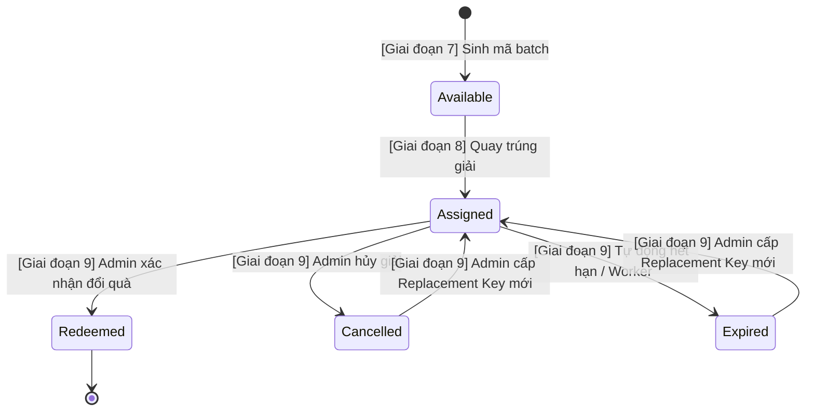

# Giai đoạn 9: Prize Claim, Cancellation, Expiration, Replacement Key & Admin History

## 1. Mục tiêu và phạm vi

- **Mục tiêu:** Hoàn thiện toàn bộ vòng đời của mã trúng thưởng (`PrizeKey`) sau khi người chơi quay trúng giải (`Win`) ở Giai đoạn 8, triển khai các nghiệp vụ Admin xác nhận đổi quà (Redeem), Hủy giải (Cancel), Tự động hết hạn (Expiration Worker), Cấp mã thay thế (Replacement Key) và Truy vấn lịch sử vận hành Admin (Spin History & Key Details).
- **Phạm vi đã thực hiện:**
  - **Admin Redeem:** `POST /api/admin/prize-keys/{prizeKeyId}/redeem` — Xác nhận trao giải, chuyển `Assigned -> Redeemed`, tạo bản ghi `PrizeRedemption`, ghi vết `AuditLog`.
  - **Admin Cancel:** `POST /api/admin/prize-keys/{prizeKeyId}/cancel` — Hủy giải thưởng vi phạm/không hợp lệ, chuyển `Assigned -> Cancelled`, ghi vết `AuditLog` với lý do bắt buộc.
  - **Automatic Expiration Worker:** `PrizeKeyExpirationBackgroundService` (.NET 8 built-in `BackgroundService`) — Định kỳ quét và chuyển `Assigned -> Expired` cho các key quá hạn `ExpiresAtUtc <= UtcNow`.
  - **Admin Manual Expire Trigger:** `POST /api/admin/prize-keys/expire-overdue` — Thao tác vận hành dành cho Admin quét hết hạn theo lô an toàn.
  - **Replacement Key:** `POST /api/admin/prize-keys/{prizeKeyId}/replacement` — Cấp mã mới an toàn (AES-256-GCM + SHA-256 hash) cho key gốc đã `Cancelled` hoặc `Expired`, liên kết qua `ReplacesPrizeKeyId` với Unique Filtered Index chống trùng lặp.
  - **Admin Spin History Query:** `GET /api/admin/wheels/{wheelId}/spins` — Tra cứu lịch sử quay thưởng theo Wheel, phân trang, lọc theo Version/Prize/Result/Status/Date/Token/Email, che giấu email (`q***v@gmail.com`), bảo mật tuyệt đối không trả plaintext key hay token bí mật.
  - Toàn bộ 199 unit test và 83 integration test tự động đều vượt qua 100%.

---

## 2. Vòng đời và State Machine của PrizeKey



### Bảng chuyển đổi trạng thái hợp lệ:

| Trạng thái ban đầu | Hành động | Trạng thái tiếp theo | Điều kiện |
| :--- | :--- | :--- | :--- |
| `Available` | Quay trúng giải (Spin Win) | `Assigned` | Người chơi quay trúng ô có giải |
| `Assigned` | Admin Redeem | `Redeemed` | `UtcNow < ExpiresAtUtc`, chưa từng redeem |
| `Assigned` | Admin Cancel | `Cancelled` | Reason hợp lệ, chưa redeem/expire |
| `Assigned` | Background Worker Expire | `Expired` | `UtcNow >= ExpiresAtUtc` |
| `Cancelled` | Admin Create Replacement | `Assigned` (Key mới) | Key gốc giữ nguyên `Cancelled`, sinh key mới liên kết `ReplacesPrizeKeyId` |
| `Expired` | Admin Create Replacement | `Assigned` (Key mới) | Key gốc giữ nguyên `Expired`, sinh key mới liên kết `ReplacesPrizeKeyId` |

> [!CAUTION]
> **Quy tắc bất biến:**
> 1. Key đã trả cho người chơi hoặc đã ở trạng thái `Assigned`, `Redeemed`, `Cancelled`, `Expired` **tuyệt đối không bao giờ quay lại `Available`**.
> 2. `Redeemed`, `Cancelled`, `Expired` là các trạng thái kết thúc (terminal state) của một key cụ thể.
> 3. Cấp lại quà là hành động **sinh một PrizeKey hoàn toàn mới** với entropy, nonce, tag và ciphertext mới, không tái sử dụng mã cũ.

---

## 3. Đặc tả API Giai đoạn 9

Tất cả các endpoint đều yêu cầu Header `Authorization: Bearer <AdminToken>` và Policy `AdminOnly`.

### 3.1 Admin Redeem PrizeKey
- **Endpoint:** `POST /api/admin/prize-keys/{prizeKeyId}/redeem`
- **Request Body:**
  ```json
  {
    "note": "Đã xác minh CMND và trao voucher tại cửa hàng"
  }
  ```
- **Response HTTP 200 OK:**
  ```json
  {
    "prizeKeyId": "9b1deb4d-3b7d-4bad-9bdd-2b0d7b3dcb6d",
    "spinId": "110e8400-e29b-41d4-a716-446655440010",
    "status": "Redeemed",
    "redeemedAtUtc": "2026-08-25T00:00:00Z",
    "note": "Đã xác minh CMND và trao voucher tại cửa hàng"
  }
  ```
- **Mã lỗi thường gặp:**
  - `404 NOT_FOUND`: Không tìm thấy PrizeKey.
  - `409 PRIZE_KEY_NOT_ASSIGNED`: Key không ở trạng thái `Assigned`.
  - `409 PRIZE_KEY_EXPIRED`: Key đã quá thời hạn nhận thưởng.
  - `409 PRIZE_KEY_ALREADY_REDEEMED`: Key đã được redeem trước đó.

---

### 3.2 Admin Cancel PrizeKey
- **Endpoint:** `POST /api/admin/prize-keys/{prizeKeyId}/cancel`
- **Request Body:**
  ```json
  {
    "reason": "Phát hiện tài khoản vi phạm chính sách sự kiện"
  }
  ```
- **Response HTTP 200 OK:**
  ```json
  {
    "prizeKeyId": "9b1deb4d-3b7d-4bad-9bdd-2b0d7b3dcb6d",
    "spinId": "110e8400-e29b-41d4-a716-446655440010",
    "status": "Cancelled",
    "cancelledAtUtc": "2026-08-25T00:00:00Z",
    "reason": "Phát hiện tài khoản vi phạm chính sách sự kiện"
  }
  ```
- **Mã lỗi thường gặp:**
  - `400 VALIDATION_ERROR`: `reason` trống hoặc vượt quá 1000 ký tự.
  - `404 NOT_FOUND`: Không tìm thấy PrizeKey.
  - `409 PRIZE_KEY_NOT_ASSIGNED`: Key không ở trạng thái `Assigned`.

---

### 3.3 Admin Tạo Replacement Key
- **Endpoint:** `POST /api/admin/prize-keys/{prizeKeyId}/replacement`
- **Request Body:** `{}` (hoặc không có body)
- **Response HTTP 200 OK:**
  ```json
  {
    "newPrizeKeyId": "888e8400-e29b-41d4-a716-446655440888",
    "originalPrizeKeyId": "9b1deb4d-3b7d-4bad-9bdd-2b0d7b3dcb6d",
    "prizeId": "3fa85f64-5717-4562-b3fc-2c963f66afa6",
    "spinId": "110e8400-e29b-41d4-a716-446655440010",
    "status": "Assigned",
    "assignedAtUtc": "2026-08-25T00:00:00Z",
    "expiresAtUtc": "2026-08-25T01:00:00Z",
    "code": "LW-2345-6789-WXYZ-9876"
  }
  ```
- **Mã lỗi thường gặp:**
  - `404 NOT_FOUND`: Không tìm thấy key gốc.
  - `409 PRIZE_KEY_INVALID_STATUS_FOR_REPLACEMENT`: Key gốc không phải `Cancelled` hoặc `Expired`.
  - `409 PRIZE_KEY_REPLACEMENT_ALREADY_EXISTS`: Key gốc đã được cấp replacement key trước đó.

---

### 3.4 Admin Quét Hết Hạn Thủ Công (Expire Overdue)
- **Endpoint:** `POST /api/admin/prize-keys/expire-overdue?batchSize=100`
- **Response HTTP 200 OK:**
  ```json
  {
    "processedCount": 5,
    "successCount": 5,
    "failedCount": 0,
    "expiredKeyIds": [
      "9b1deb4d-3b7d-4bad-9bdd-2b0d7b3dcb6d"
    ]
  }
  ```

---

### 3.5 Admin Tra Cứu Lịch Sử Quay Thưởng (Wheel Spins History)
- **Endpoint:** `GET /api/admin/wheels/{wheelId}/spins?pageNumber=1&pageSize=20&result=Win&status=Completed`
- **Response HTTP 200 OK:**
  ```json
  {
    "items": [
      {
        "id": "110e8400-e29b-41d4-a716-446655440010",
        "wheelId": "550e8400-e29b-41d4-a716-446655440000",
        "wheelVersionId": "660e8400-e29b-41d4-a716-446655440001",
        "versionNumber": 1,
        "maskedEmail": "n***g@gmail.com",
        "result": "Win",
        "status": "Completed",
        "prizeId": "3fa85f64-5717-4562-b3fc-2c963f66afa6",
        "prizeName": "Voucher 500k",
        "prizeKeyId": "9b1deb4d-3b7d-4bad-9bdd-2b0d7b3dcb6d",
        "prizeKeyStatus": "Redeemed",
        "createdAtUtc": "2026-08-25T00:00:00Z",
        "cancelledAtUtc": null,
        "cancellationReason": null
      }
    ],
    "page": 1,
    "pageSize": 20,
    "totalCount": 1
  }
  ```

---

## 4. Background Expiration Worker

- **Kiến trúc:** Triển khai bằng `PrizeKeyExpirationBackgroundService` kế thừa `BackgroundService` chuẩn của .NET 8, đăng ký qua `AddHostedService`.
- **Cấu hình qua `appsettings.json`:**
  ```json
  "PrizeKeyExpiration": {
    "IntervalSeconds": 60,
    "BatchSize": 100,
    "Enabled": true,
    "DefaultClaimDurationMinutes": 60
  }
  ```
- **Xử lý an toàn:**
  - Mỗi chu kỳ tạo một `IServiceScope` mới để inject `IPrizeKeyExpirationProcessor` và `ApplicationDbContext`.
  - Sử dụng ExecutionStrategy và Transaction cô lập cho từng key, không khóa toàn bộ bảng.
  - Tự động bỏ qua và ghi log cảnh báo khi xảy ra `DbUpdateConcurrencyException` do tranh chấp với Admin Redeem/Cancel.
  - Xử lý `CancellationToken` gọn gàng khi ứng dụng dừng (graceful shutdown).

---

## 5. Kiểm soát đồng thời & Giao dịch nguyên tử

1. **Khóa chống trùng mã thay thế:**
   - Cột `ReplacesPrizeKeyId` trong bảng `PrizeKeys` có ràng buộc **Unique Filtered Index**:
     ```sql
     CREATE UNIQUE INDEX [IX_PrizeKeys_ReplacesPrizeKeyId] ON [PrizeKeys] ([ReplacesPrizeKeyId])
     WHERE [ReplacesPrizeKeyId] IS NOT NULL;
     ```
   - Hai request đồng thời cố gắng tạo replacement key cho cùng một key gốc sẽ bị chặn ở cấp độ cơ sở dữ liệu và ném lỗi 409 `PRIZE_KEY_REPLACEMENT_ALREADY_EXISTS`.
2. **Khóa chống Redeem trùng lặp:**
   - Bảng `PrizeRedemptions` có Unique Index trên `PrizeKeyId` và `SpinId`.
   - `PrizeKey` có `RowVersion` optimistic concurrency token ngăn chặn race condition giữa Redeem, Cancel và Expire.

---

## 6. Migration cơ sở dữ liệu

- **Tên migration:** `20260825000000_AddPrizeKeyLifecycleAndReplacement.cs`
- **Nội dung:**
  - Thêm cột `ReplacesPrizeKeyId` (nullable `uniqueidentifier`) vào bảng `PrizeKeys`.
  - Thêm khóa ngoại tự tham chiếu `FK_PrizeKeys_PrizeKeys_ReplacesPrizeKeyId`.
  - Thêm Unique Filtered Index `IX_PrizeKeys_ReplacesPrizeKeyId`.

---

## 7. Hướng dẫn chạy kiểm thử

Chạy toàn bộ test tự động:
```powershell
dotnet test
```

Kết quả:
- **Unit Tests:** 199/199 passed.
- **Integration Tests:** 83/83 passed.
- **Tổng cộng:** 282 tests passed 100%.
